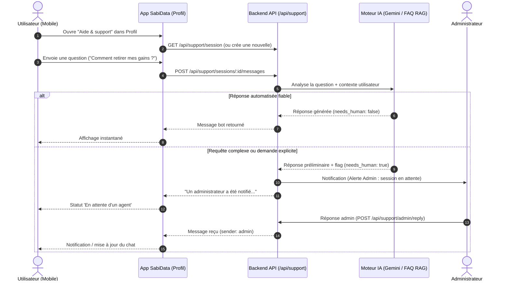

# Plan d'implémentation : Chatbot d'assistance & Escalade Admin

Ce document présente l'architecture, la feuille de route et le journal de suivi pour l'intégration d'un **chatbot d'assistance intelligent avec relais administrateur** dans la section Profil de l'application mobile **SabiData**.

---

## 1. Objectifs & Enjeux

1. **Réduire le temps de latence de support** : Fournir aux contributeurs des réponses immédiates (24/7) sur les questions fréquentes (rémunération FCFA, seuils de retrait, soumission et validation des clips audio, langues supportées Mooré/Dioula/Fulfuldé/Gulmancema, statut KYC).
2. **Escalade intelligente vers l'humain** : Détecter quand la requête nécessite l'intervention d'un administrateur (contestation de gain, problème technique bloquant, incompréhension du bot, ou demande explicite de l'utilisateur).
3. **Notification en temps réel de l'admin** : Alerter l'équipe d'administration (Webhook, Email, Push ou tableau de bord admin) dès qu'une session est escaladée, avec l'historique complet pour reprise en main.
4. **Cohérence avec la charte SabiData** : Respecter les tokens du thème clair « Sahel » (`AppColors`, typographies `Bricolage Grotesque` / `Plus Jakarta Sans`, composants existants).

---

## 2. Architecture Globale

---

## 3. Découpage des Étapes d'Implémentation

| Étape | Intitulé | Statut | Livrables clés |
| :---: | :--- | :---: | :--- |
| **01** | **Contrat API & Architecture Backend / Alerte** | ✅ Terminé | Contrat d'API REST (`docs/support-chatbot-api-contract.md`), format de session, messages, webhook d'alerte admin. |
| **02** | **Couche Données Mobile (Models & Service API)** | ✅ Terminé | Modèles `SupportMessage`, `SupportSession`, énums `MessageSender` et `SessionStatus`, service `SupportApi` avec fallback intelligent. |
| **03** | **Interface Utilisateur Chatbot (SupportChatScreen)** | ✅ Terminé | Écran complet `SupportChatScreen` aux couleurs Sahel, bulles différenciées, suggestions rapides, indicateur de frappe. |
| **04** | **Intégration dans le Profil & Navigation** | ✅ Terminé | Câblage de l'option "Aide & support" dans `ProfileScreen`, enregistrement de la route `/support` dans `router.dart`. |
| **05** | **Logique d'Escalade Humaine & Notification Admin** | ✅ Terminé | Alerte manuelle via bouton d'en-tête, détection automatique par mots-clés, bannière de statut admin. |
| **06** | **Mode Hors-ligne, Tests & Polissage** | ✅ Terminé | Gestion du mode hors-ligne/repli autonome, tests unitaires (`test/support_chat_test.dart`), polissage UX. |
| **07** | **Documentation Backend & Guide Opérations Admin** | ✅ Terminé | `docs/BACKEND_CHATBOT_IMPLEMENTATION_GUIDE.md` (pour les devs back) & `docs/ADMIN_SUPPORT_PROCEDURES_GUIDE.md` (pour l'administrateur). |

---

## 4. Détail des Étapes

### Étape 01 : Spécification & Contrat API
- **Spécifications des routes backend** :
  - `GET /api/support/session` : Récupère la session active de l'utilisateur ou en ouvre une nouvelle.
  - `POST /api/support/sessions/:id/messages` : Envoie un message utilisateur et reçoit la réponse du bot (avec indicateur `escalated: bool`).
  - `POST /api/support/sessions/:id/escalate` : Forcer l'escalade manuelle vers l'administrateur.
  - `GET /api/support/sessions/:id/status` : Suivi du statut (actif, escaladé, résolu).
- **Format d'alerte admin** :
  - Payload structuré envoyé au canal d'alerte admin (identifiant utilisateur, solde, question posée, contexte).

### Étape 02 : Couche Données Mobile (Flutter)
- Création du modèle `lib/data/models/support_message.dart` :
  - `id`, `text`, `sender` (`user`, `bot`, `admin`, `system`), `createdAt`, `isEscalated`.
- Création du service `lib/data/api/support_api.dart` :
  - Méthodes `getSession()`, `sendMessage()`, `escalateSession()`.

### Étape 03 : Interface Utilisateur (UI/UX Chatbot)
- Création de `lib/screens/support_chat_screen.dart` :
  - En-tête avec `MotifHeader` (motif SabiData, bouton retour).
  - Zone de défilement des messages (Bulles utilisateur rouge/orange, bulles bot/admin surface claire avec badge distinctif).
  - Suggestions rapides (chips horizontaux : "Retrait Mobile Money", "Comment valider un clip", "Parler à un humain").
  - Champ de saisie ergonomique (`TextField` adapté au mobile) avec bouton d'envoi.

### Étape 04 : Navigation & Liaison avec l'écran Profil
- Dans `lib/screens/profile_screen.dart` :
  - Remplacement du simple `showAppSnack` sur "Aide & support" par `context.push('/support-chat')`.
- Dans `lib/router.dart` :
  - Enregistrement de `/support-chat` dans les routes authentifiées (`_authRoutes`).

### Étape 05 : Système d'Escalade et Prise de Relais
- Ajout d'une action "Demander l'aide d'un agent" accessible dans l'en-tête ou sous forme de bouton contextuel dans le chat.
- Affichage d'un indicateur de statut :
  - Badge *« En attente d'un agent humain »*
  - Message système clair informant l'utilisateur que l'admin prend le relais.
- Polling / rafraîchissement périodique léger des messages quand la conversation est en statut `escalated`.

### Étape 06 : Robustesse & Validation
- Gestion de la perte de réseau avec fallback convivial (message hors-ligne explicite).
- Validation de l'ergonomie (clavier virtuel qui ne masque pas la zone de saisie, `SingleChildScrollView` / `ListView.builder` inversé).
- Tests de cohérence visuelle avec le reste de l'application.

---

## 5. Journal de Suivi (Résumés par étape)

Ce journal sera mis à jour à chaque avancement :

| Date | Étape | Résumé de l'avancement |
| :--- | :---: | :--- |
| *(Init)* | Planification | Analyse du projet SabiData, cadrage des besoins, conception du schéma d'escalade et validation du plan d'action. |
| 16/11/2026 | Étape 1 : Contrat API & Alerte Admin | Spécification complète des endpoints (`/api/support/sessions/...`), du modèle de données (session, messages, expéditeurs) et du format de webhook d'alerte administrateur dans `docs/support-chatbot-api-contract.md`. |
| 16/11/2026 | Étape 2 : Couche Données Mobile | Création de `lib/data/models/support_message.dart` et `lib/data/api/support_api.dart`. Prise en charge des expéditeurs (user, bot, admin, system), détection d'intention d'escalade et base de connaissances SabiData (gains FCFA, enregistrement, validation). |
| 16/11/2026 | Étape 3 : Interface Utilisateur Chatbot | Création de `lib/screens/support_chat_screen.dart` : motif textile SabiData, bulles différenciées (utilisateur dégradé rouge/orange, bot surface blanche avec badge, admin avec accent bleu/vérifié), suggestions rapides en chips horizontaux, barre de saisie ergonomique et indicateur de frappe. |
| 16/11/2026 | Étape 4 : Navigation & Câblage Profil | Modification de `lib/screens/profile_screen.dart` (option "Aide & support" branchée sur `/support`), déclaration de la route protégée `/support` dans `lib/router.dart`. |
| 16/11/2026 | Étape 5 : Escalade Humaine & Alerte Admin | Intégration d'un bouton d'alerte dans l'en-tête avec boîte de dialogue de confirmation, détection automatique des litiges/demandes d'agent par analyse textuelle, et affichage d'une bannière dorée de notification de relais admin. |
| 16/11/2026 | Étape 6 : Robustesse Hors-ligne & Tests | Implémentation du moteur de repli autonome pour un fonctionnement fluide même sans backend, création de la suite de tests unitaires `test/support_chat_test.dart` (sérialisation, modèles, moteur de support, escalade manuelle et automatique). |
| 16/11/2026 | Étape 7 : Guides Backend & Procédures Admin | Rédaction du guide d'implémentation backend complet (`docs/BACKEND_CHATBOT_IMPLEMENTATION_GUIDE.md`) incluant schémas SQL, endpoints REST, prompt système Gemini Flash et webhook d'alerte ; rédaction du guide des procédures opérationnelles pour l'administrateur (`docs/ADMIN_SUPPORT_PROCEDURES_GUIDE.md`) avec fiches réflexes (retraits, audio, comptes) et scripts de réponse. |
